<div align="center">

# 🛡️ SOC Lab: Attack Simulation & Threat Detection

**A purple-team exercise against an Active Directory Domain Controller — attacked, detected, and documented end-to-end.**


</div>

---

## 📋 Table of Contents

- [Executive Summary](#-executive-summary)
- [Attack Chain & Detection Summary](#-attack-chain--detection-summary)
- [Lab Topology](#-lab-topology)
- [Methodology](#-methodology)
- [INC-001 — Network Reconnaissance](#inc-001--network-reconnaissance)
- [INC-002 — SMB Brute Force Authentication](#inc-002--smb-brute-force-authentication)
- [INC-003 — Privilege Escalation & Persistence](#inc-003--privilege-escalation--persistence)
- [INC-004 — Log Tampering / Anti-Forensics](#inc-004--log-tampering--anti-forensics)
- [Splunk Dashboard](#-splunk-dashboard)
- [MITRE ATT&CK Matrix](#-mitre-attck-matrix)
- [Conclusion](#-conclusion)

---

## 📝 Executive Summary

This report covers a purple-team exercise run in a lab that I built myself. The goal was to act out a multi-step attack against an Active Directory Domain Controller. I walked through the full attack lifecycle includes reconnaissance, credential access, privilege escalation, and anti-forensics on every stage. I need to  Identify whether the detection tools caught what was happening. I used **Splunk Enterprise** as a host-based SIEM and **Security Onion** as a network-based Network Security Monitoring (NSM) solution.

I caught every stage of the attack. The exercise also turned up two real detection gaps that I found and fixed in the middle of the work:

1. **Reconnaissance activity leaves no trace in host-based Windows Event Logs.** Network-layer visibility was needed to spot it.
2. **Windows' default audit policy does not log scheduled-task creation events.** That meant a persistence technique (T1053.005) stayed invisible until I explicitly corrected the audit policy.

The exercise ends with a demonstration of the most important finding: **centralized log forwarding to a SIEM beats anti-forensics.** When the attacker wiped the Windows Security event log to cover their tracks, the proof of the earlier attack stages was still fully intact in Splunk  because it had already been ingested in near real time.

**Objectives:** Validate Windows Security log ingestion by investigating reconnaissance, repeated authentication failures, and privileged group changes, while assessing scheduled-task auditing and log-clearing detection.

## 🎯 Attack Chain & Detection Summary

| Stage | Attack | MITRE ATT&CK | Detected By | Status |
|---|---|---|---|---|
| **INC-001** | Network Reconnaissance (Nmap) | T1595 | Security Onion via Suricata | ✅ Detected |
| **INC-002** | SMB Brute Force (NetExec) | T1110 | Splunk (EventCode 4625) | ✅ Detected |
| **INC-003** | Privilege Escalation & Persistence | T1136 / T1098 / T1053.005 | Splunk (4720 / 4728 / 4698) | ✅ Detected |
| **INC-004** | Security Log Tampering | T1070.001 | Splunk (EventCode 1102) | ✅ Detected |

## 🖧 Lab Topology

| Role | System | IP Address |
|---|---|---|
| Attacker | Kali Linux 2026.2 | `192.168.3.1` |
| Target | Windows Server 2019 (AD Domain Controller) | `192.168.1.102` |
| SIEM | Splunk Enterprise | installed on the DC |
| NSM | Security Onion | Suricata + Elastic stack |

## 🔬 Methodology

Each incident in this report follows a consistent structure mirroring real SOC analyst workflow:

- **Alert Triggered** — what fired (search / signature)
- **MITRE ATT&CK Mapping** — Tactic + Technique ID
- **Initial Triage** — source, host, and timestamp
- **Investigation** — the actual command/query used, with screenshot evidence
- **Indicators of Compromise (IOC)**
- **Severity / Impact**
- **Containment & Response**
- **Lessons Learned / Recommendation**

This structure follows the **NIST SP 800-61 Incident Response Lifecycle**:
1. *Preparation*
2. *Detection & Analysis*
3. *Containment/Eradication/Recovery*
4. *Post-Incident Activity*

---

## INC-001 — Network Reconnaissance

`🟡 SEVERITY: LOW`

| Field | Value |
|---|---|
| **Date/Time** | 2026-11-24, ~06:46 (Kali) / 07:54 UTC (Suricata) |
| **Analyst** | Syukri Hasbullah |
| **MITRE ATT&CK** | T1595 – Active Scanning (Reconnaissance) |
| **Status** | Detected using Suricata via Security Onion |

### Alert Triggered

Suricata, via Security Onion, fired on Nmap's version-detection scripting engine traffic, flagging the activity as a network scan.

### Initial Triage

- **Source:** Kali Linux attacker host
- **Target:** Active Directory Domain Controller (domain `test.local`)
- **Target IP:** `192.168.1.102`
- **Tool:** Nmap 7.99

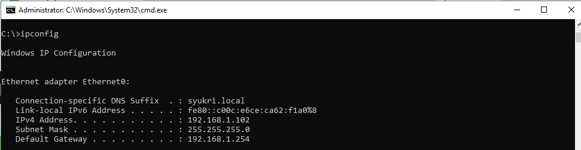

*Figure 1.1 — Confirming the target's IP configuration.*

Network reconnaissance identified services consistent with an Active Directory domain controller. Suricata generated a network alert during the exercise. Host Security logs alone did not provide equivalent reconnaissance visibility.

### 🗡️ Attack — Network Reconnaissance

In order to test the Network Security Monitoring, a full TCP port scan with service/version detection was run against the Domain Controller:

```bash
nmap -sS -sV -p- 192.168.1.102
```

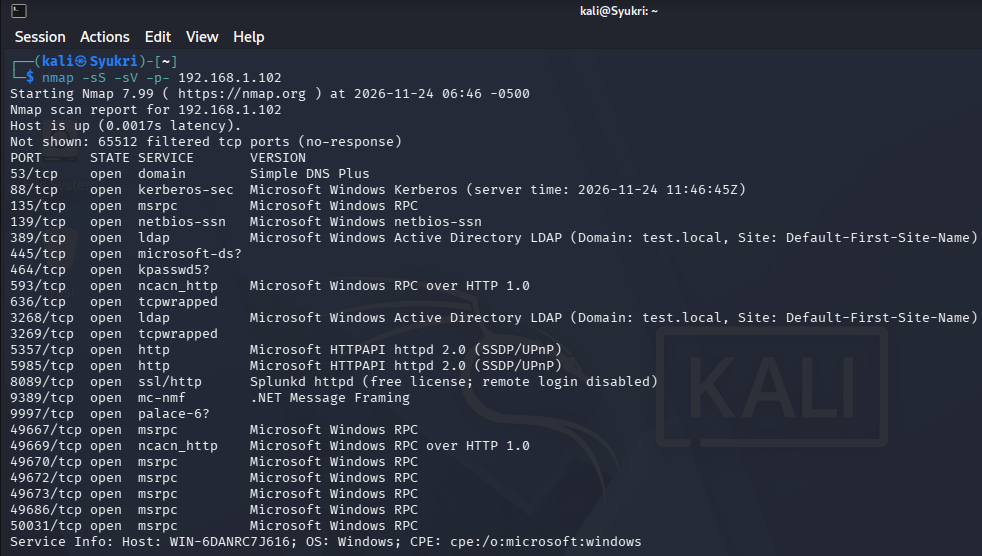

*Figure 1.2 — Nmap scan result revealing the target is a fully-functioning Domain Controller. Several ports were identified: Kerberos (88), LDAP/GC (389/3268), SMB (445), WinRM (5985), and an exposed Splunk management port (8089).*

### 🛡️ Defense — Detection via Security Onion / Suricata

Network telemetry is necessary to complement host authentication and audit records. The alert is evidence of observed activity. The reconnaissance scan from the attacker's Kali Linux host triggered Suricata rule **2023753** (`ET SCAN MS Terminal Server Traffic on Non-standard Port`) **18 times** against `192.168.1.102` on port **49690**.

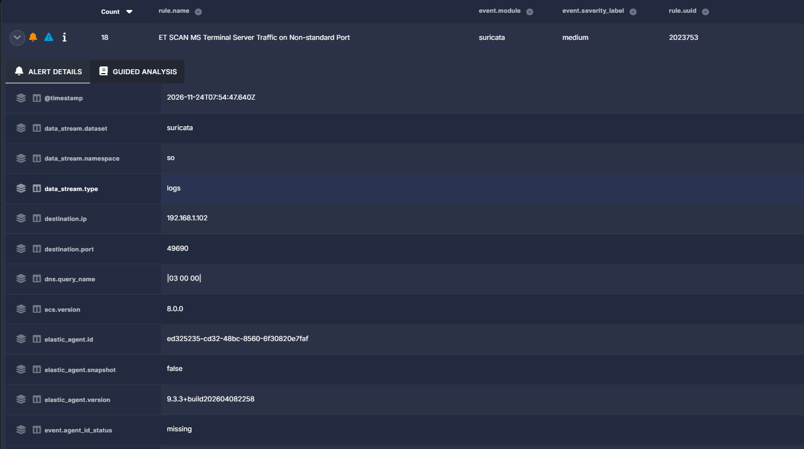

*Figure 1.3 — The ET (Emerging Threat) SCAN MS Terminal Server Traffic and ET (Emerging Threat) SCAN Nmap Scripting Engine User-Agent signatures both fired, with `destination.ip` matching the scanned host (192.168.1.102).*

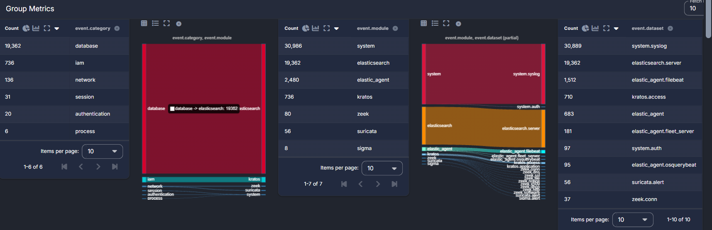

*Figure 1.4 — Supporting network telemetry overview confirming active Suricata/Zeek sensor coverage.*

### Indicators of Compromise

| Type | Value |
|---|---|
| Target IP | 192.168.1.102 |
| Target role | AD Domain Controller (test.local) |
| Key open ports | 88, 389/3268, 445, 5985, 8089 |

### Severity, Impact & Response

**Low severity.** This first phase was reconnaissance only — no exploitation occurred. However, it fully fingerprinted the target as a Domain Controller and informed the subsequent attack stages. No blocking action was taken at this stage to allow the attack chain to continue for training purposes.

### 💡 Lessons Learned

- Detection gap confirmed: Windows Security Event Logs alone did **not** capture this reconnaissance activity.
- Network-level visibility (Security Onion/Suricata) was required and worked as expected — demonstrating that SIEM and NSM are complementary, not redundant.
- **Recommendation:** maintain network sensor (SPAN/mirror) coverage on all key segments.

---

## INC-002 — SMB Brute Force Authentication

`🟠 SEVERITY: HIGH`

> **Note:** The original plan targeted RDP, but INC-001 showed port 3389 was not exposed. The attack was pivoted to SMB (port 445). Hydra's SMB module failed against this target (a known limitation against modern SMB2/3 stacks), so **NetExec (nxc)** was used instead.

| Field | Value |
|---|---|
| **Date/Time** | 2026-11-24, ~04:09–04:21 |
| **MITRE ATT&CK** | T1110 – Brute Force (Credential Access) |
| **Source IP** | 192.168.3.1 (Kali) |
| **Target** | `192.168.1.102` / Administrator @ test.local |
| **Tool** | NetExec |
| **Result** | All 7 attempts failed — password not in the wordlist |
| **Status** | Detected by Splunk EventCode 4625 |

### 🗡️ Attack — SMB Brute Force

**Step 1 — Build the attack wordlist** for brute-forcing authentication. A small custom wordlist was built for lab demonstration purposes:

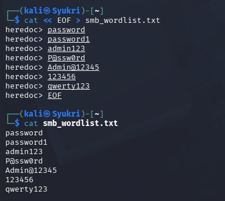

*Figure 2.1 — Custom SMB password wordlist.*

**Step 2 — Brute force via NetExec:**

```bash
nxc smb 192.168.1.102 -u Administrator -p smb_wordlist.txt
```

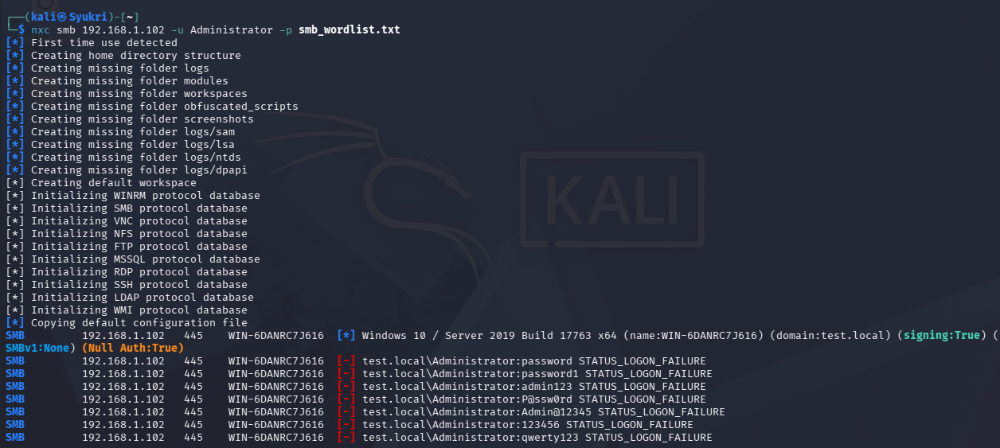

*Figure 2.2 — All 7 attempts returned `STATUS_LOGON_FAILURE` — a realistic outcome, and still fully valuable for analysis.*

### 🛡️ Defense — Detection of 7 unsuccessful login attempts in Splunk

The controlled SMB authentication test produced seven failed attempts against the `Administrator` account. Splunk returned Event ID 4625 records using NTLM, with source network address `192.168.3.1`. No successful authentication was established by this test.

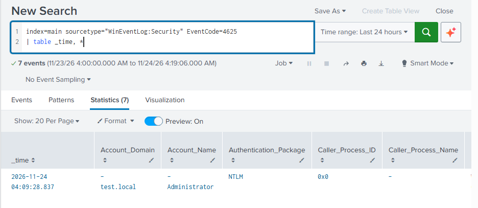

*Figure 2.3 — Failed authentication event search.*

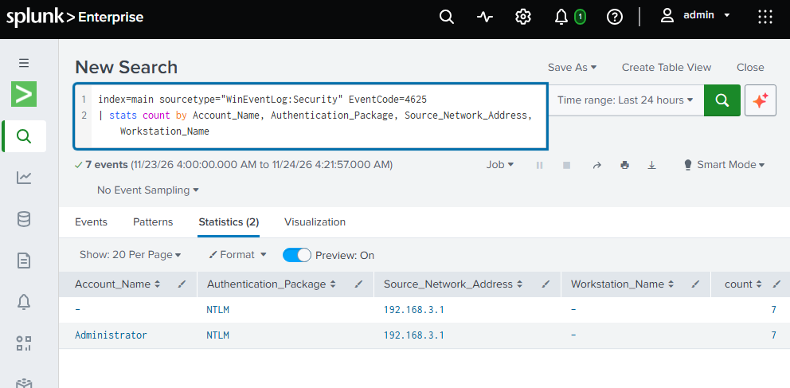

*Figure 2.4 — Aggregated failed authentication evidence.*

### Severity, Impact & Response

**High severity.** An active credential compromise attempt against a privileged account on a Domain Controller. The recommended response is to block the source IP at the firewall, verify account lockout policy, and review for brute-force attempts against other accounts.

### 💡 Lessons Learned

- Enforce account lockout thresholds on privileged accounts.
- Always verify actual field names (`| table _time, *`) before building detections, rather than assuming Common Information Model (CIM)-normalized fields are present.

---

## INC-003 — Privilege Escalation & Persistence

`🔴 SEVERITY: CRITICAL`

> **Scenario note:** Since the SMB brute force in INC-002 did not succeed, this stage simulates an **assumed-breach scenario** — the attacker already holds valid privileged credentials (maybe via phishing or pass-the-hash in a real engagement) and proceeds to escalate privileges and establish persistence.

| Field | Value |
|---|---|
| **Date/Time** | 2026-11-24, ~04:32–05:10 |
| **MITRE ATT&CK** | T1136 / T1098 / T1053.005 |
| **New accounts** | `hacker1_syook`, `hacker2_syook` |
| **Escalated to** | Domain Admins |
| **Persistence** | Scheduled task (`WindowsUpdateCheck` / `SystemUpdateSvc`), runs as SYSTEM |
| **Status** | Detected after remediating an audit policy gap |

### 🗡️ Attack — Privilege Escalation

**Step 1 — Create a new domain account:**
```powershell
net user hacker1_syook Password12345 /add /domain
```
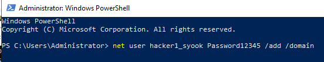

**Step 2 — Escalate privileges by adding to Domain Admins:**
```powershell
net group "Domain Admins" hacker1_syook /add /domain
```
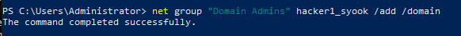

**Step 3 — Establish persistence via scheduled task:**
```powershell
schtasks /create /tn "WindowsUpdateCheck" /tr "powershell.exe -WindowStyle Hidden -Command Write-Host Persistence" /sc onlogon /ru SYSTEM
```
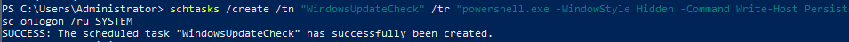

###  Defense — Initial detection in Splunk

Account creation (4720) and group change (4728) were detected immediately:

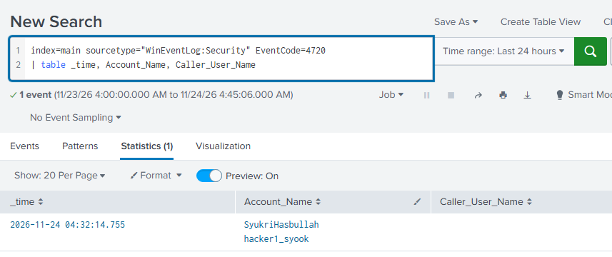

*Figure 3.1 — EventCode 4720. Account creation event in Splunk.*

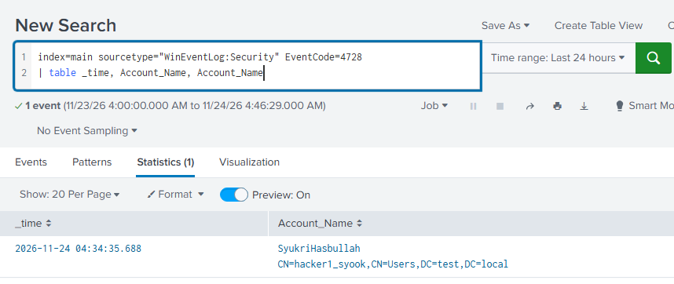

*Figure 3.2 — EventCode 4728 detected as expected.*

However, the scheduled task creation (**EventCode 4698**) returned **zero events** — even though the command succeeded on the host. Root cause: the **"Other Object Access Events"** audit subcategory was not enabled by default.

**I remediated the audit policy gap:**

```powershell
auditpol /set /subcategory:"Other Object Access Events" /success:enable /failure:enable
auditpol /set /subcategory:"User Account Management" /success:enable /failure:enable
auditpol /set /subcategory:"Security Group Management" /success:enable /failure:enable
```

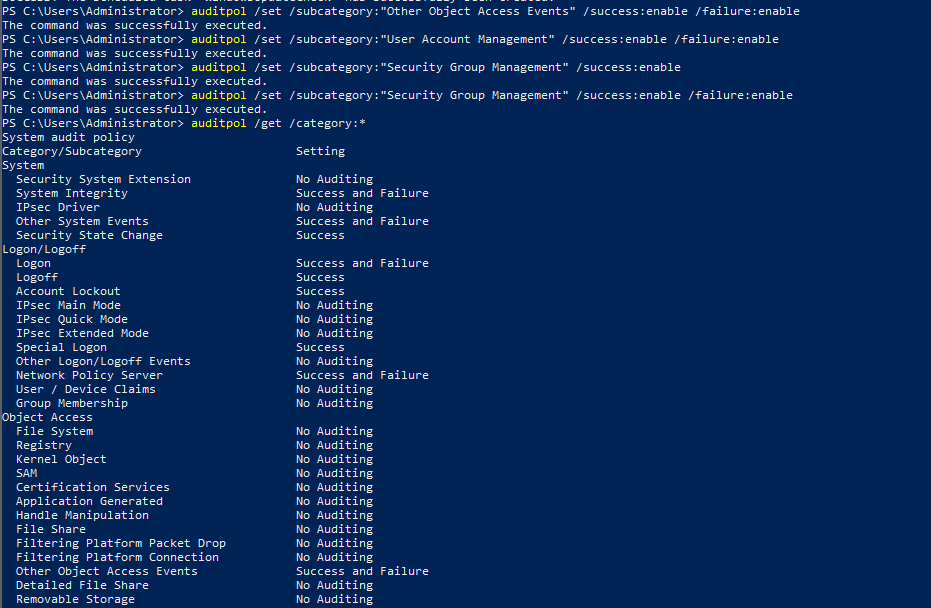

*Figure 3.3 — Enabling the missing audit subcategories.*

Then I repeated the same steps for `hacker2_syook` — and all events were now detected:

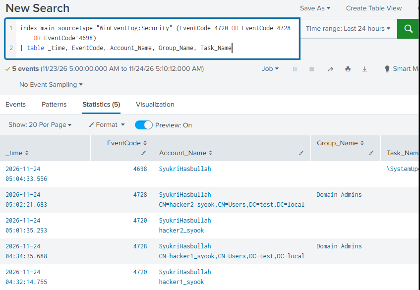

*Figure 3.4 — All 5 events now visible: account creation, Domain Admins escalation, and the scheduled task (`\SystemUpdateSvc`) — fully attributed to `SyukriHasbullah`.*

### Severity, Impact & Response

**Critical severity** — the attacker established persistent, domain-wide privileged access plus a SYSTEM-level scheduled task, surviving even a credential rotation. The response: immediately disable the rogue accounts, remove Domain Admins membership, remove the scheduled tasks, and audit the domain for further persistence.

### 💡 Lessons Learned

- **Real detection gap found and fixed:** Windows' default audit policy does not enable "Other Object Access Events," leaving scheduled-task persistence (T1053.005) invisible out of the box.
- Apply a baseline Advanced Audit Policy via GPO across all domain-joined systems.
- Alert on the pattern `EventCode=4720` followed shortly by `EventCode=4728` which a strong persistence/privilege-escalation indicator.

---

## INC-004 — Log Tampering / Anti-Forensics

`🔴 SEVERITY: CRITICAL`

| Field | Value |
|---|---|
| **Date/Time** | 2026-11-24, ~05:21–05:25 |
| **MITRE ATT&CK** | T1070.001 – Clear Windows Event Logs (Defense Evasion) |
| **Account** | SyukriHasbullah |
| **Status** | Detected — Splunk EventCode 1102 |

The controlled log-clearing scenario resulted in a Windows Security log containing a log-clear event. Splunk also returned Event ID 1102 records, and earlier collected account and task events remained searchable in the source evidence.

### 🗡️ Attack — Log Tampering / Anti-Forensics

The attacker clears the Security log:

```powershell
wevtutil cl Security
```
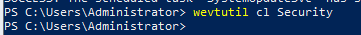

**Confirm locally that the log was wiped** (Windows Event Viewer):

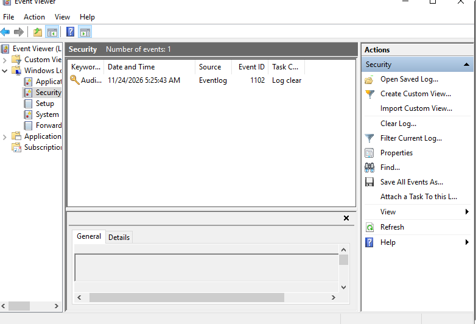

*Figure 4.1 — Locally, the Security log now contains a single event: EventCode 1102 ("Log clear"). Every other event including all INC-003 activity — has been wiped locally.*

### 🛡️ Defense — Confirm Splunk captured the clearing event

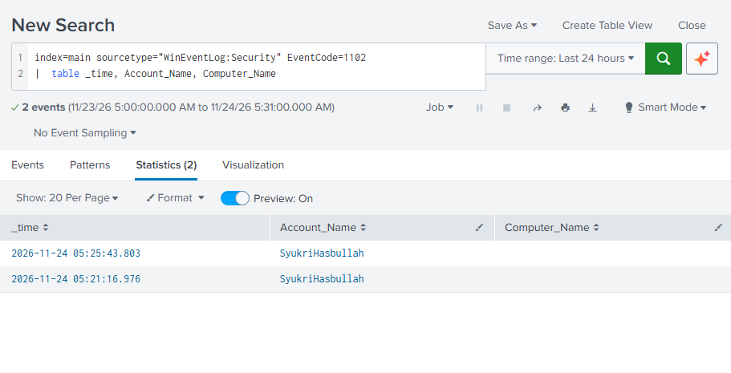

*Figure 4.2 — EventCode 1102 detected in Splunk, attributed to `SyukriHasbullah`.*

**The critical check:** does the INC-003 evidence still exist in Splunk, despite being wiped locally?

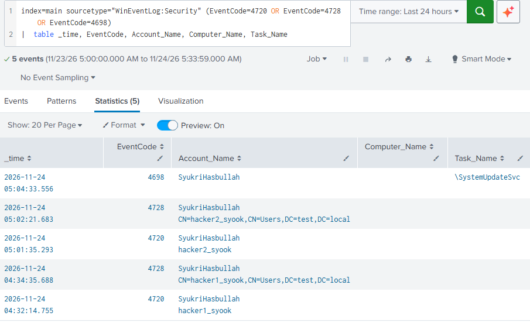

*Figure 4.3 — All 5 events from INC-003 (account creation, Domain Admins escalation, scheduled task) remain fully intact in Splunk, even though they no longer exist in the local Windows Event Viewer.*

### 🏆 Key Finding

> This is the single most important finding of the entire exercise: **centralized log forwarding to a SIEM defeats local anti-forensics.** The attacker's attempt to cover their tracks locally had zero effect on the evidence already ingested by Splunk.

### Severity, Impact & Response

**Critical severity** — any account clearing Security logs should be treated as fully compromised. The response: disable the account immediately, isolate the host for forensic imaging, and reconstruct the attack timeline from the Splunk-retained pre-clearing events.

### 💡 Lessons Learned

- Maintain a standing, non-suppressed, high-priority alert on EventCode 1102 — legitimate administrators rarely need to clear the Security log.
- Consider write-once/immutable storage for forwarded logs on critical systems such as Domain Controllers.

> *This incident closes the attack chain: **Reconnaissance (INC-001), Credential Access (INC-002), Privilege Escalation & Persistence (INC-003) → Defense Evasion (INC-004)** with detection coverage holding at every single stage.*

---

## 📊 Splunk Dashboard

To bring everything together, I built a Splunk Dashboard Studio dashboard that visualizes the whole attack chain at a glance an attack timeline across every EventCode involved, plus live KPI counters for the two highest-signal detections.

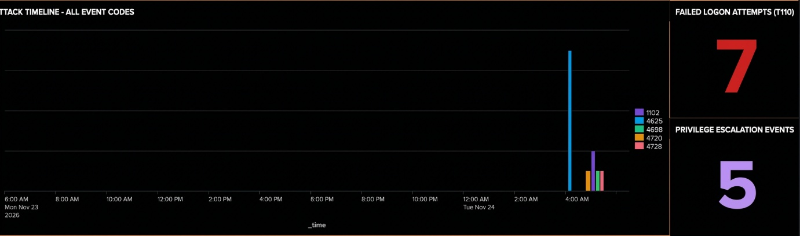

*Attack Timeline (all EventCodes: 1102, 4625, 4698, 4720, 4728) alongside two KPI cards — **7 Failed Logon Attempts (T1110)** and **5 Privilege Escalation Events** — giving a single-glance view of the entire incident, the same way a SOC analyst console would.*

---

## 🎯 MITRE ATT&CK Matrix

| Stage | Tactic | Technique | Detected By |
|---|---|---|---|
| Reconnaissance | Reconnaissance | T1595 – Active Scanning | Security Onion (Suricata) |
| SMB Brute Force | Credential Access | T1110 – Brute Force | Splunk (4625) |
| Account Creation | Persistence | T1136 – Create Account | Splunk (4720) |
| Domain Admins Escalation | Privilege Escalation | T1098 – Account Manipulation | Splunk (4728) |
| Scheduled Task | Persistence | T1053.005 – Scheduled Task | Splunk (4698, after audit fix) |
| Log Clearing | Defense Evasion | T1070.001 – Clear Windows Event Logs | Splunk (1102) |

### Detection Coverage Summary

| Attack Stage | Splunk (Host) | Security Onion (Network) |
|---|---|---|
| Reconnaissance | No native signal |  Detected — ET SCAN signatures |
| SMB Brute Force |  Detected — EventCode 4625 | — Not evaluated |
| Privilege Escalation / Persistence | Detected — 4720/4728/4698 | — Not evaluated |
| Log Tampering | Detected — EventCode 1102, evidence preserved | — Not evaluated |

> This demonstrates why a mature SOC relies on both **SIEM** (host/application telemetry) and **NSM** (network telemetry) — neither alone provides full visibility across the kill chain.

---

## Conclusion

This exercise successfully demonstrated full-lifecycle detection coverage of a realistic attack chain against an Active Directory Domain Controller, using a combination of host-based (Splunk) and network-based (Security Onion) monitoring.

**Key takeaways:**

- **SIEM and NSM are complementary** — reconnaissance was invisible to host logs but caught by the network sensor; all subsequent stages were caught by the SIEM.
- **Default configurations are not sufficient** — a real audit policy gap (missing "Other Object Access Events") was discovered and fixed during the exercise, a finding directly transferable to production environments.
- **Centralized logging is a decisive defense against anti-forensics** — local log clearing had no effect on the SIEM's evidence trail.

> *This lab was conducted entirely within an isolated, self-hosted virtual environment for educational and training purposes. No external networks or third-party systems were targeted.*

---

<div align="center">

📊 SPL queries used: [`detection-rules/splunk-spl-queries.md`](detection-rules/splunk-spl-queries.md)
🗺️ MITRE mapping: [`mitre-attack-matrix.md`](mitre-attack-matrix.md)

</div>
