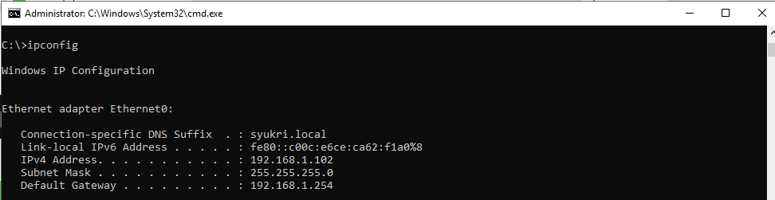
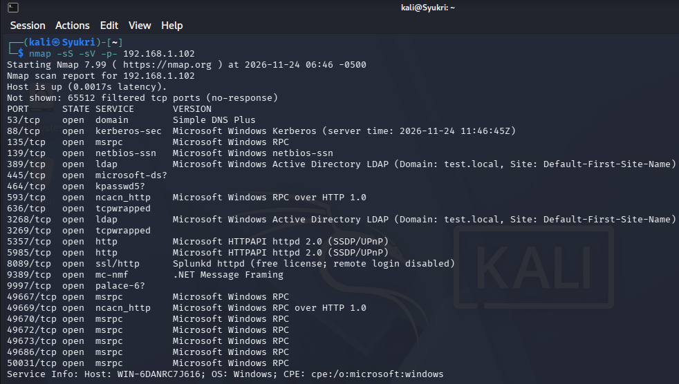
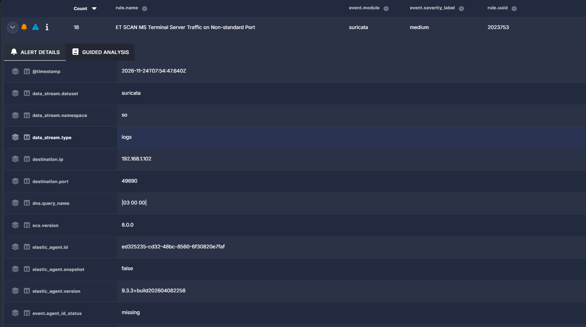
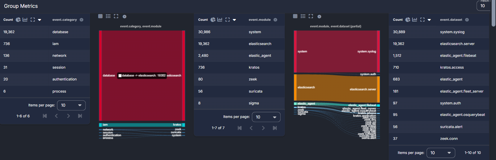

# INC-001 – Network Reconnaissance (Port Scan)

| Field | Value |
|---|---|
| **Date/Time Detected** | 2026-11-24, ~06:46 (Kali local) / 07:54 UTC (Suricata timestamp) |
| **Analyst** | Syukri Hasbullah |
| **Severity** | Low |
| **Status** | Detected ✅ |

## 1. Alert Triggered

Suricata (via Security Onion) fired on Nmap's version-detection scripting engine traffic, flagging it as scan activity.

## 2. MITRE ATT&CK Mapping

- **Tactic:** Reconnaissance
- **Technique:** T1595 – Active Scanning

## 3. Initial Triage

- **Source IP (attacker):** Kali Linux
- **Target host:** `WIN-6DANRC7J616` — Active Directory Domain Controller (domain `test.local`)
- **Target IP:** `192.168.1.102`
- **Tool used:** Nmap 7.99 (`-sS -sV -p-`)



## 4. Investigation

Full TCP port scan with service/version detection against the Domain Controller:

```bash
nmap -sS -sV -p- 192.168.1.102
```



The scan revealed the target is a fully-functioning Domain Controller — Kerberos (88), LDAP/Global Catalog (389/3268), SMB (445), WinRM (5985), and even the Splunk management port (8089) exposed.

**Detection — Security Onion / Suricata alert detail:**



The `ET SCAN MS Terminal Server Traffic on Non-standard Port` and `ET SCAN Nmap Scripting Engine User-Agent Detected` signatures both fired, confirming the scanning activity was visible at the network layer. `destination.ip` in the alert matches the scanned host (`192.168.1.102`).

**Supporting telemetry — Security Onion overview** (shows NSM visibility across event categories/modules, confirming Suricata/Zeek sensors are actively ingesting traffic):



## 5. Indicators of Compromise (IOC)

| Type | Value |
|---|---|
| Source IP | Kali attacker host |
| Target IP | 192.168.1.102 |
| Target role | AD Domain Controller (test.local) |
| Key open ports | 88 (Kerberos), 389/3268 (LDAP/GC), 445 (SMB), 5985 (WinRM), 8089 (Splunkd) |
| Suricata signatures | ET SCAN Nmap Scripting Engine User-Agent Detected; ET SCAN MS Terminal Server Traffic on Non-standard Port |

## 6. Severity / Impact

Low — reconnaissance only, no exploitation occurred. However, it fully fingerprinted the target as a Domain Controller and enumerated viable attack surfaces (SMB, Kerberos, WinRM), directly informing the next attack stage.

## 7. Containment & Response

No blocking action taken at this stage (lab exercise — chain allowed to continue for detection training purposes). In a real environment: flag source IP for monitoring, correlate with subsequent authentication activity from the same source.

## 8. Lessons Learned / Recommendation

- **Detection gap confirmed:** Windows Security Event Log alone did **not** capture this reconnaissance activity — host-based logging has no visibility into unsuccessful/pre-authentication network scanning.
- Network-level visibility (Security Onion/Suricata) was required to detect this stage, and it worked as expected — demonstrating why **SIEM (Splunk) and NSM (Security Onion) are complementary**, not redundant.
- Recommendation: maintain network sensor coverage (SPAN/mirror) on all key network segments, and consider enabling Windows Firewall connection logging as an additional host-based signal.
