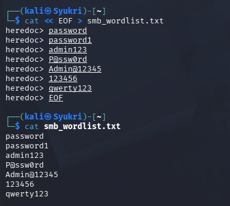
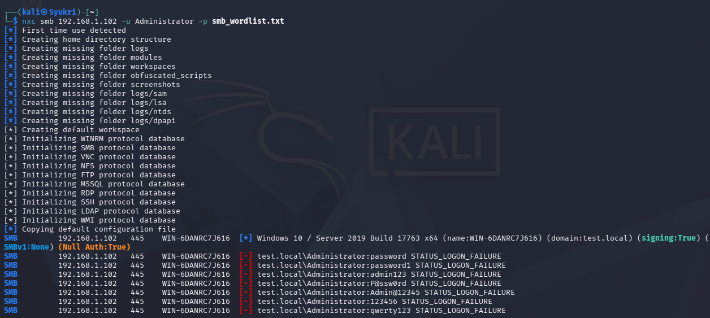
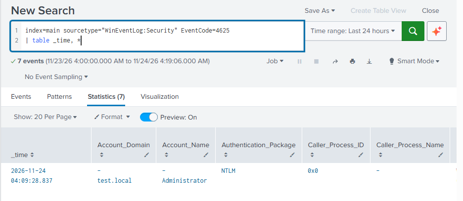
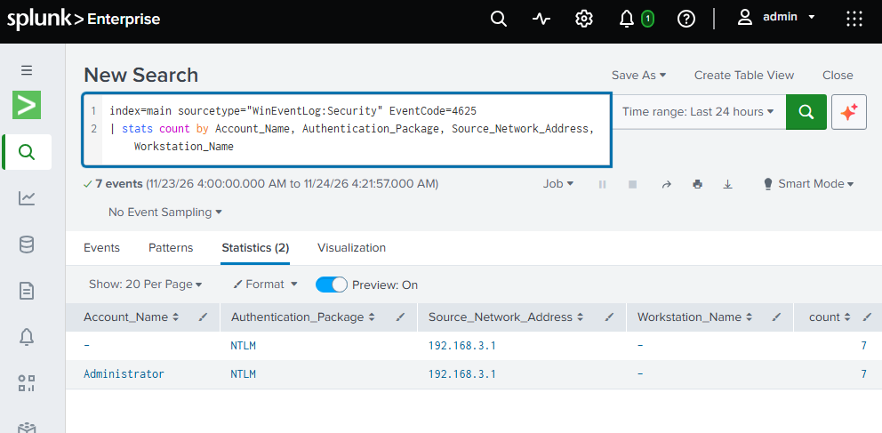

# INC-002 – SMB Brute Force Authentication

| Field | Value |
|---|---|
| **Date/Time Detected** | 2026-11-24, ~04:09–04:21 (Splunk server time) |
| **Analyst** | Syukri Hasbullah |
| **Severity** | High |
| **Status** | Detected ✅ |

> **Note:** The original plan targeted RDP, but the Nmap scan in INC-001 showed port 3389 was not exposed on the target. The attack was pivoted to **SMB (port 445)**, which was open. Hydra's SMB module failed against this target (`invalid reply` — a known limitation against modern SMB2/3 stacks), so the attack was carried out with **NetExec (nxc)** instead.

## 1. Alert Triggered

Splunk search detected 7 consecutive failed logon events (EventCode 4625) against the `Administrator` account within a short window.

**Search used to detect:**
```spl
index=main sourcetype="WinEventLog:Security" EventCode=4625
| stats count by Account_Name, Authentication_Package, Source_Network_Address, Workstation_Name
```

## 2. MITRE ATT&CK Mapping

- **Tactic:** Credential Access
- **Technique:** T1110 – Brute Force

## 3. Initial Triage

- **Source IP (attacker):** `192.168.3.1` (Kali)
- **Target account:** `Administrator`
- **Target host:** `WIN-6DANRC7J616` (test.local Domain Controller)
- **Authentication package:** NTLM
- **Number of failed attempts:** 7

## 4. Investigation

**Step 1 — build a small custom wordlist** (for lab demo purposes, rather than a full dictionary attack):



**Step 2 — brute force via NetExec** (Hydra's SMB module failed with `invalid reply` against this Windows Server 2019 target, so NetExec was used instead):

```bash
nxc smb 192.168.1.102 -u Administrator -p smb_wordlist.txt
```



All 7 attempts returned `STATUS_LOGON_FAILURE` — the attack did not succeed (the real password was not in the wordlist), which is a realistic outcome and still fully valuable for detection-engineering purposes.

**Step 3 — field discovery in Splunk** (default WinEventLog field names differ from CIM-normalized names like `src_ip`/`dest`; confirmed actual fields via raw event inspection):



**Step 4 — final detection query:**



Result: `Account_Name=Administrator`, `Source_Network_Address=192.168.3.1`, `count=7` — an exact match to the 7 NetExec attempts, confirming full detection fidelity.

## 5. Indicators of Compromise (IOC)

| Type | Value |
|---|---|
| Source IP | 192.168.3.1 |
| Targeted account | Administrator |
| Authentication package | NTLM |
| Failed attempt count | 7 |
| Tool identified | NetExec (nxc) |

## 6. Severity / Impact

High — represents an active credential compromise attempt against a privileged account (`Administrator`) on a Domain Controller. Even though this specific attempt failed, a successful brute force here would mean full domain compromise.

## 7. Containment & Response

- Block attacker source IP (`192.168.3.1`) at the firewall (pfSense).
- Verify account lockout policy is enforced for `Administrator` / privileged accounts.
- Review for any other brute-force attempts against other accounts in the same window.

## 8. Lessons Learned / Recommendation

- Hydra's legacy SMB module is unreliable against modern Windows Server SMB2/3 — **NetExec/CrackMapExec is the correct tool** for AD-focused SMB authentication testing.
- Enforce account lockout thresholds on privileged accounts to limit brute-force attempts.
- Enable MFA or restrict SMB/management-port access to a jump host where possible.
- Default WinEventLog field names in Splunk did not match CIM-normalized names — a reminder to always verify actual field names (`| table _time, *`) before building detection searches, rather than assuming Splunk Add-on field extractions are present.
