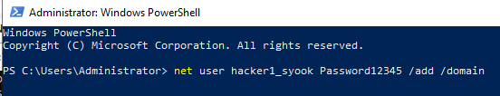
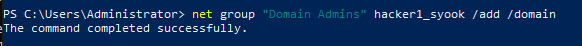
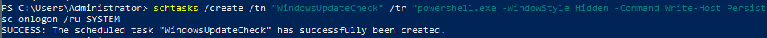
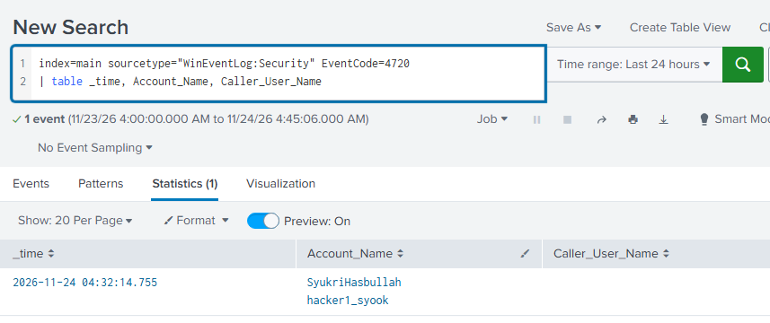
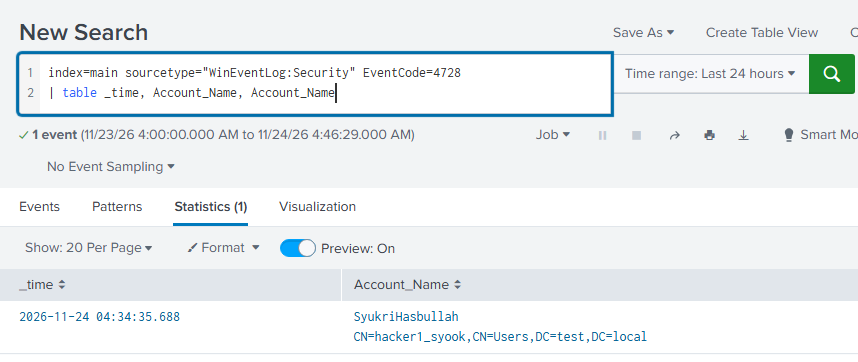
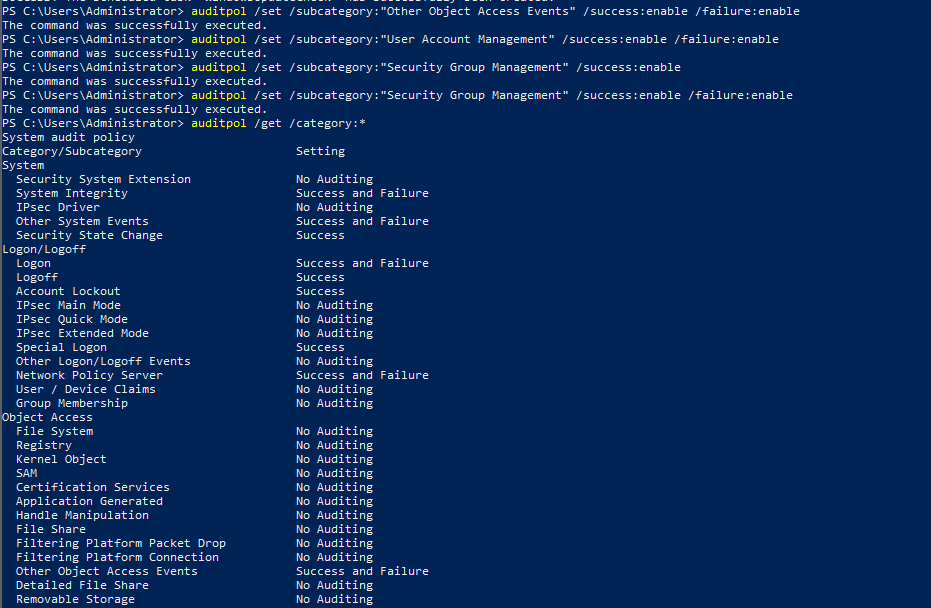
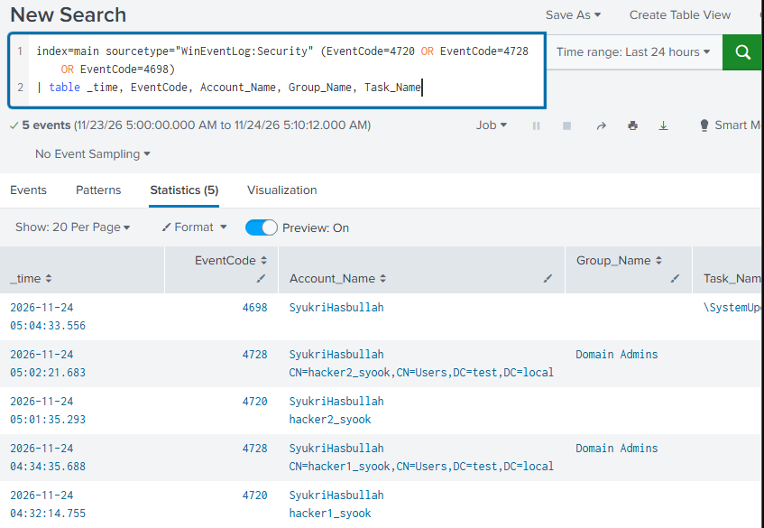

# INC-003 – Privilege Escalation & Persistence

| Field | Value |
|---|---|
| **Date/Time Detected** | 2026-11-24, ~04:32–05:10 (Splunk server time) |
| **Analyst** | Syukri Hasbullah |
| **Severity** | Critical |
| **Status** | Detected ✅ (after remediating an audit policy gap) |

> **Scenario note:** Since the SMB brute force in INC-002 did not succeed, this stage simulates an **assumed-breach scenario** — the attacker has already obtained valid privileged credentials (e.g. via phishing, pass-the-hash, or a successful brute force in a real-world engagement) and is now escalating privileges and establishing persistence.

## 1. Alert Triggered

Splunk searches on EventCode 4720 (account created), 4728 (member added to a global security group), and 4698 (scheduled task created).

## 2. MITRE ATT&CK Mapping

- **Tactic:** Persistence / Privilege Escalation
- **Technique:** T1136 – Create Account, T1098 – Account Manipulation, T1053.005 – Scheduled Task

## 3. Initial Triage

- **New accounts created:** `hacker1_syook`, `hacker2_syook`
- **Created by:** `SyukriHasbullah` (the compromised/attacker-controlled admin account)
- **Group escalated to:** Domain Admins
- **Persistence mechanism:** Scheduled task `WindowsUpdateCheck` / `SystemUpdateSvc` running as SYSTEM, triggered on logon
- **Host affected:** `WIN-6DANRC7J616` (test.local Domain Controller)

## 4. Investigation

**Step 1 — create a new domain account:**
```powershell
net user hacker1_syook Password12345 /add /domain
```


**Step 2 — escalate privileges by adding to Domain Admins:**
```powershell
net group "Domain Admins" hacker1_syook /add /domain
```


**Step 3 — establish persistence via scheduled task:**
```powershell
schtasks /create /tn "WindowsUpdateCheck" /tr "powershell.exe -WindowStyle Hidden -Command Write-Host Persistence" /sc onlogon /ru SYSTEM
```


**Step 4 — initial detection attempt in Splunk:**

Account creation (4720) and group membership change (4728) were detected immediately:




However, the **scheduled task creation (EventCode 4698) returned 0 events** — even though the command itself succeeded on the host. Root cause: the `Other Object Access Events` audit subcategory was **not enabled by default**.

**Step 5 — remediate the audit policy gap:**
```powershell
auditpol /set /subcategory:"Other Object Access Events" /success:enable /failure:enable
auditpol /set /subcategory:"User Account Management" /success:enable /failure:enable
auditpol /set /subcategory:"Security Group Management" /success:enable /failure:enable
```


**Step 6 — repeat the attack sequence** (new account `hacker2_syook`, re-create scheduled task) and re-run detection:

```spl
index=main sourcetype="WinEventLog:Security" (EventCode=4720 OR EventCode=4728 OR EventCode=4698)
| table _time, EventCode, Account_Name, Group_Name, Task_Name
```



All 5 events now visible: account creation, privilege group escalation, and the scheduled task (`\SystemUpdateSvc`) — fully attributed to `SyukriHasbullah`.

## 5. Indicators of Compromise (IOC)

| Type | Value |
|---|---|
| New account names | `hacker1_syook`, `hacker2_syook` |
| Privileged group modified | Domain Admins |
| Scheduled task name | `WindowsUpdateCheck`, `SystemUpdateSvc` |
| Task run-as | SYSTEM |
| Caller account | SyukriHasbullah |

## 6. Severity / Impact

Critical — the attacker established persistent, domain-wide privileged access (Domain Admins) plus a SYSTEM-level scheduled task for continued access, even if the original compromised credentials are later rotated.

## 7. Containment & Response

- Disable/delete the rogue accounts (`hacker1_syook`, `hacker2_syook`) immediately.
- Remove them from the Domain Admins group.
- Remove the malicious scheduled tasks from the Domain Controller.
- Audit all other scheduled tasks and privileged group memberships domain-wide for additional persistence.
- Rotate credentials for the account that performed these actions.

## 8. Lessons Learned / Recommendation

- **Real detection gap found and fixed during this exercise:** Windows' default audit policy does **not** enable `Other Object Access Events`, meaning scheduled-task-based persistence (T1053.005) is invisible to Splunk out of the box, even with Security log forwarding fully working. This is a genuine, common real-world SOC blind spot.
- Apply a baseline **Advanced Audit Policy** (via GPO) across all domain-joined systems rather than relying on default auditing.
- Alert on the pattern `EventCode=4720` followed shortly by `EventCode=4728` — this sequence is a strong persistence/privilege-escalation indicator.
- Apply least-privilege principles; restrict who can create accounts or modify group membership on a Domain Controller.
