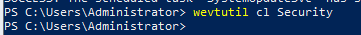
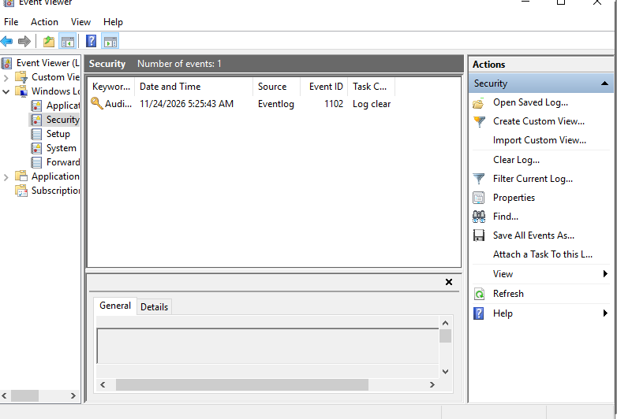
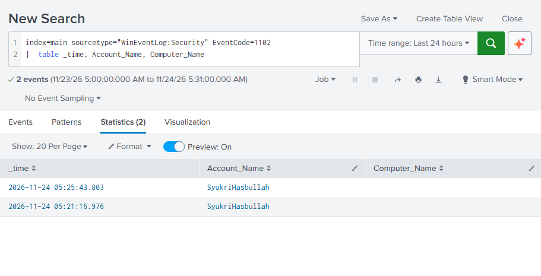
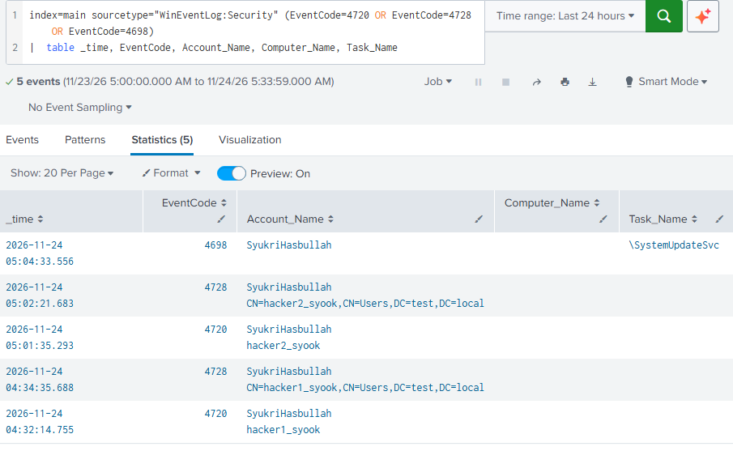

# INC-004 – Log Tampering / Anti-Forensics

| Field | Value |
|---|---|
| **Date/Time Detected** | 2026-11-24, ~05:21–05:25 (Splunk server time) |
| **Analyst** | Syukri Hasbullah |
| **Severity** | Critical |
| **Status** | Detected ✅ |

## 1. Alert Triggered

Splunk alert on EventCode 1102 — the Windows Security event log was cleared.

**Search used to detect:**
```spl
index=main sourcetype="WinEventLog:Security" EventCode=1102
| table _time, Account_Name, Computer_Name
```

## 2. MITRE ATT&CK Mapping

- **Tactic:** Defense Evasion
- **Technique:** T1070.001 – Clear Windows Event Logs

## 3. Initial Triage

- **Account that cleared the log:** `SyukriHasbullah`
- **Host affected:** `WIN-6DANRC7J616`
- **Number of clear events:** 2
- **Note:** EventCode 1102 is itself generated *because* the log was cleared — it is the one event that survives the clearing action, making it a high-value, hard-to-evade detection.

## 4. Investigation

**Step 1 — attacker clears the Security log:**
```powershell
wevtutil cl Security
```


**Step 2 — confirm locally the log was wiped** (Windows Event Viewer):



Locally, the Security log now contains a single event: EventCode 1102 ("Log clear"). Every other event — including all of the privilege escalation activity from INC-003 — has been wiped from the local log.

**Step 3 — confirm Splunk captured the clearing event:**



**Step 4 — the critical check: does the evidence from INC-003 still exist in Splunk, despite being wiped locally?**

```spl
index=main sourcetype="WinEventLog:Security" (EventCode=4720 OR EventCode=4728 OR EventCode=4698)
| table _time, EventCode, Account_Name, Computer_Name, Task_Name
```



**Result: all 5 events from INC-003 (account creation, Domain Admins escalation, scheduled task) are still present in Splunk**, even though they no longer exist in the local Windows Event Viewer. This is the central finding of the lab: because logs were forwarded to Splunk in near real-time, the attacker's attempt to cover their tracks locally had no effect on the centralized evidence trail.

## 5. Indicators of Compromise (IOC)

| Type | Value |
|---|---|
| Account used | SyukriHasbullah |
| Host | WIN-6DANRC7J616 |
| Clear events | 2 (05:21:16, 05:25:43) |
| Pre-clearing evidence preserved in Splunk | Yes — EventCode 4720, 4728, 4698 all intact |

## 6. Severity / Impact

Critical — a strong indicator of deliberate anti-forensic activity. Any account clearing Security logs should be treated as fully compromised and investigated immediately. In this exercise, the attempt to cover tracks ultimately failed because of centralized log forwarding.

## 7. Containment & Response

- Treat the account that triggered EventCode 1102 as compromised; disable immediately and force credential rotation.
- Isolate the host for forensic imaging before further changes occur.
- Rely on the Splunk-retained copies of pre-clearing events (4720/4728/4698) to reconstruct the full attack timeline, since local logs are no longer trustworthy.
- In a real incident, escalate to full incident response / forensics.

## 8. Lessons Learned / Recommendation

- **This is the single most important finding of the entire lab:** centralized log forwarding to a SIEM defeats local anti-forensics. Even a fully successful local log wipe did not erase the evidence trail, because Splunk had already ingested the events in near real-time.
- Maintain a standing, non-suppressed, high-priority alert on EventCode 1102 — it should almost always indicate malicious activity, since legitimate administrators rarely need to clear the Security log.
- Consider write-once/immutable storage (or a separate retention tier) for forwarded logs on critical systems such as Domain Controllers.
- This incident closes the attack chain: **Recon (INC-001) → Credential Access (INC-002) → Privilege Escalation & Persistence (INC-003) → Defense Evasion (INC-004)** — and demonstrates that detection coverage held at every single stage.
